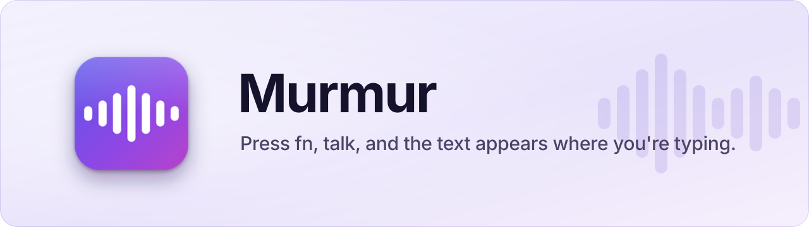
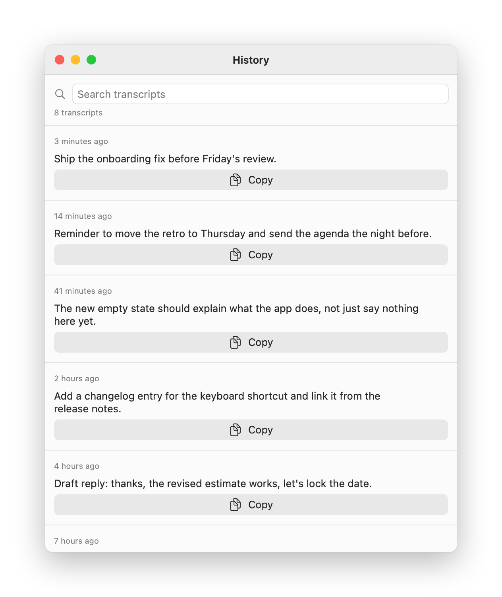
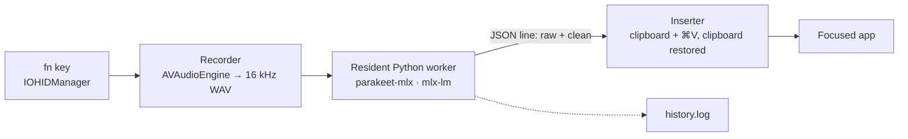

<p align="center">
  
</p>

<p align="center">
  
  
  
  
  
</p>

---

Tap `fn` to start listening and tap it again to stop. Murmur transcribes the audio and pastes the text into the focused field: Slack, Notes, Chrome, Xcode, any app. You get the experience of cloud dictation tools, but the audio never leaves your Mac.

| | |
|---|---|
| **144 ms** | to transcribe 5.7 s of speech, about 40× real time (M1 Max) |
| **0 network calls** | the worker runs with `HF_HUB_OFFLINE=1`, and the app binary contains no networking symbols |
| **3 permissions** | Microphone, Accessibility, Input Monitoring. Nothing else. |
| **~1,600 lines** | Swift + one Python worker, no third-party Swift dependencies |

<p align="center">
  
</p>

<p align="center">
  <picture>
    <source media="(prefers-color-scheme: dark)" srcset=".github/murmur-hud-listening-dark.png">
    
  </picture>
  <picture>
    <source media="(prefers-color-scheme: dark)" srcset=".github/murmur-hud-transcribing-dark.png">
    
  </picture>
</p>

<p align="center">
  <picture>
    <source media="(prefers-color-scheme: dark)" srcset=".github/murmur-history-dark.png">
    
  </picture>
</p>

## Features

- **`fn` (globe) key trigger**, toggle on and off. Right `⌥` is available as an alternative.
- **Parakeet TDT v3** speech recognition through [`parakeet-mlx`](https://github.com/senstella/parakeet-mlx). Clips over 30 s are split into overlapping 20 s chunks.
- **Smart cleanup** (optional): Qwen3 4B, also on-device, removes fillers and stutters and applies spoken self-corrections ("Monday, no, Tuesday" → "Tuesday") while keeping your wording. A guard rejects any rewrite that shrinks the text below 55% or makes it longer, and falls back to the raw transcript.
- **History window**: search across your 50 most recent transcripts and copy any of them with one click. The log is append-only and nothing is ever trimmed.
- **Floating HUD** that shows listening and transcribing states. The start chime plays on the first captured audio buffer, not on the key press, so you never talk into a microphone that isn't recording yet.

## Architecture



The Swift app talks to a resident Python worker over a stdin/stdout pipe, one JSON line per request. The worker stays loaded because a cold `import mlx` takes longer than the transcription itself. It runs as a child process, so quitting Murmur also stops the worker.

| File | Role |
|---|---|
| `FnHIDMonitor.swift` | Reads `fn` straight off the HID device (vendor usage page `0x00FF`, usage `0x03`) |
| `FnHotKey.swift` | `CGEventTap` for the right `⌥` alternative |
| `Recorder.swift` | Mic tap, engine paused between dictations, survives input-device changes |
| `Engines.swift` | Resident child-process wrapper and output scrubbing |
| `Inserter.swift` | Pastes into the frontmost app and restores your clipboard afterwards |
| `HistoryStore.swift` | Append-only log; reads only the tail, so load time stays flat as the log grows |
| `Resources/parakeetd.py` | The worker: transcription, chunking, cleanup, Metal cache management |

## Engineering notes

**`fn` doesn't send keyboard events.** When "Press 🌐 key to" is set to *Do Nothing*, the window server drops the key before any app sees it. No `CGEventTap` or `NSEvent` monitor receives it, even though `shift` and `⌥` come through. The only way to read it is one layer lower: `IOHIDManager` on Apple's vendor usage page. That route needs Input Monitoring permission, not Accessibility.

**A 24 GB memory leak that Activity Monitor couldn't see.** After a day of uptime, the worker had a **23.8 GB** physical footprint across 4,700 Metal buffer regions, while `ps` reported **52 MB**. MLX's caching allocator keeps freed Metal buffers, and since every utterance has a different spectrogram length, every call left behind buffers of new sizes. The fix is `mx.clear_cache()` after each transcription plus a 512 MB cache ceiling, and the warning threshold now measures MLX's own memory counters instead of RSS. In an A/B test over 20 clips, the old build climbed from 4.3 to 5.8 GB, while the patched build stayed flat around 1.4 GB with no change in latency.

**Ad-hoc signing silently revokes permissions.** macOS ties privacy permissions to the code signature, and ad-hoc signing produces a new hash on every build. Each rebuild invalidated the Accessibility grant even though System Settings still showed it as enabled. `build.sh` signs with a persistent self-signed identity, so permissions survive rebuilds.

**Finder launches get a different `PATH`.** An app launched from Finder or launchd gets `/usr/bin:/bin:/usr/sbin:/sbin`, so the worker couldn't find Homebrew's `ffmpeg`. This only appeared after a reboot, because every earlier launch had come from a terminal. The worker's `PATH` is now set explicitly.

**From 1,230 ms to 144 ms.** The first version used Whisper large-v3-turbo with a new process per dictation, and 522 ms of each run went to reloading the model. A resident `whisper-server` brought that down to 483 ms. Switching to Parakeet TDT in a resident MLX worker brought it to 144 ms.

## Install

Requires an Apple Silicon Mac on macOS 26, Homebrew `ffmpeg` and `python3`, and about 5 GB of disk for the two models.

```bash
git clone https://github.com/ramy441/murmur.git && cd murmur
./scripts/setup.sh          # one-time: venv + model download (the only network step)
./build.sh --install        # builds, signs, copies to /Applications
```

On first launch, grant Microphone, Accessibility and Input Monitoring. In System Settings › Keyboard, set "Press 🌐 key to" to *Do Nothing* so the system doesn't also react to `fn`.

To keep permissions across rebuilds, create a code-signing certificate named **Murmur Local Signing** in Keychain Access (Certificate Assistant › Create a Certificate, type *Code Signing*). Without it, `build.sh` falls back to ad-hoc signing and warns you.

| Setting | How |
|---|---|
| Turn smart cleanup off | Menu bar → Smart cleanup |
| Change the cleanup model | `MURMUR_POLISH_MODEL=<mlx repo id>`; leave it empty to disable cleanup |
| Change the trigger key | Menu bar → Trigger key |

**Uninstall:** run `./uninstall.sh`. It removes the app, venv, models, settings and signing certificate.

## Diagnostics

`~/Library/Application Support/Murmur/` holds `status.log` (permissions and model readiness at launch), `events.log` (every key press, state change, failure reason and latency, plus the raw transcript before cleanup), and `history.log`.

## Credits

- [Parakeet TDT 0.6B v3](https://huggingface.co/nvidia/parakeet-tdt-0.6b-v3) by NVIDIA, CC-BY-4.0
- [`parakeet-mlx`](https://github.com/senstella/parakeet-mlx) and [MLX](https://github.com/ml-explore/mlx), Apache-2.0
- [Qwen3 4B Instruct](https://huggingface.co/Qwen/Qwen3-4B-Instruct-2507), Apache-2.0

---

Built AI-first: designed and directed by me, implemented with Claude Code.

MIT, see [LICENSE](LICENSE).
